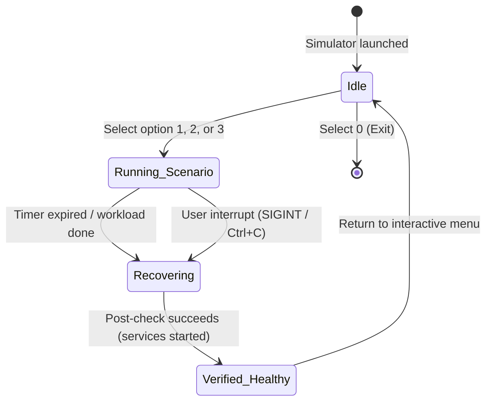

# Data Model: VM2 Extended Monitoring

**Feature**: `001-vm2-extended-monitoring` | **Date**: 2026-11-15

This document defines the schema, types, constraints, and state transitions for custom monitoring metrics, incident simulation modes, and deployment artifacts.

---

## 1. Monitoring Metric Entities

### 1.1 Metric Item Definition
Represents a specific metric collected by custom scripts and exposed via Zabbix Agent 2 UserParameter directives.

| Field Name | Type | Allowed Values | Description | Fallback Value |
|---|---|---|---|---|
| `key` | String | `custom.nginx.*`, `custom.sys.*` | Unique Zabbix item key identifier | N/A |
| `script` | Path | `/usr/local/bin/nginx_custom_metrics.sh`, `/usr/local/bin/system_health_check.sh` | Execution binary | N/A |
| `subcommand` | String | `response_ms`, `error_5xx`, `active_conn`, `zombie_procs`, `failed_units`, `disk_io_util` | Positional argument passed to script | N/A |
| `data_type` | Enum | `Numeric (unsigned)`, `Numeric (float)` | Zabbix item value storage type | `0` / `0.0` |
| `units` | String | `ms`, `!errors`, `!conn`, `!procs`, `!units`, `%` | Unit representation for visualization | N/A |
| `timeout_limit` | Integer | `3` (seconds) | Max execution time before agent aborts | N/A |

### 1.2 Metric Catalogue

| Item Key | Subcommand | Data Type | Units | Source Component | Fail-Safe Behavior |
|---|---|---|---|---|---|
| `custom.nginx.response_ms` | `response_ms` | Numeric (unsigned) | `ms` | `curl -w %{time_total} http://127.0.0.1:80/` | Returns `0` if curl fails or Nginx inactive |
| `custom.nginx.error_5xx` | `error_5xx` | Numeric (unsigned) | `!errors` | `/var/log/nginx/access.log` status code match | Returns `0` if log missing or no matches |
| `custom.nginx.active_conn` | `active_conn` | Numeric (unsigned) | `!conn` | `http://127.0.0.1:8080/basic_status` | Returns `0` if stub_status unreachable |
| `custom.sys.zombie_procs` | `zombie_procs` | Numeric (unsigned) | `!procs` | `ps -eo stat=` with state `Z` | Returns `0` if ps evaluation empty |
| `custom.sys.failed_units` | `failed_units` | Numeric (unsigned) | `!units` | `systemctl list-units --state=failed` | Returns `0` if zero broken services |
| `custom.sys.disk_io_util` | `disk_io_util` | Numeric (float) | `%` | `iostat -dx 1 2` (%util) | Returns `0.0` if iostat unavailable |

---

## 2. Incident Simulation Entity

### 2.1 Simulation Scenario Model

| Scenario ID | Name | Target Resource | Mechanism | Duration / Volume | Safe Recovery Post-Condition |
|---|---|---|---|---|---|
| `1` | CPU/RAM Overload | Host Compute & Memory | `stress-ng --cpu 2 --vm 1 --vm-bytes 70%` | 60 seconds | `stress-ng` processes terminated; load averages settle |
| `2` | HTTP Traffic Storm | Web Server Ingress | 1,000 HTTP GET requests to `http://127.0.0.1:80/` | 1,000 requests (~10s) | Ingress sockets closed; active connections return to baseline |
| `3` | Nginx Outage | Web Daemon Availability | `systemctl stop nginx` → wait → `systemctl start nginx` | 45 seconds | `systemctl is-active nginx` returns `active` |

### 2.2 Simulation State Transitions

---

## 3. Deployment Manifest Entity

### 3.1 File Deployment Mapping

| Source File (Repo) | Staging Path (VM2) | Destination Path (VM2) | Permissions | Owner:Group |
|---|---|---|---|---|
| `scripts/nginx_custom_metrics.sh` | `/tmp/zabbix_deploy/scripts/nginx_custom_metrics.sh` | `/usr/local/bin/nginx_custom_metrics.sh` | `0755` (`rwxr-xr-x`) | `root:root` |
| `scripts/system_health_check.sh` | `/tmp/zabbix_deploy/scripts/system_health_check.sh` | `/usr/local/bin/system_health_check.sh` | `0755` (`rwxr-xr-x`) | `root:root` |
| `configs/custom_monitor.conf` | `/tmp/zabbix_deploy/configs/custom_monitor.conf` | `/etc/zabbix/zabbix_agent2.d/custom_monitor.conf` | `0644` (`rw-r--r--`) | `root:root` |
| `tests/simulate_incident.sh` | `/tmp/zabbix_deploy/tests/simulate_incident.sh` | `/home/linux-moniter/simulate_incident.sh` | `0755` (`rwxr-xr-x`) | `linux-moniter:linux-moniter` |
| `deploy.sh` | `/tmp/zabbix_deploy/deploy.sh` | `/tmp/zabbix_deploy/deploy.sh` (executed & deleted) | `0755` (`rwxr-xr-x`) | `linux-moniter:linux-moniter` |
